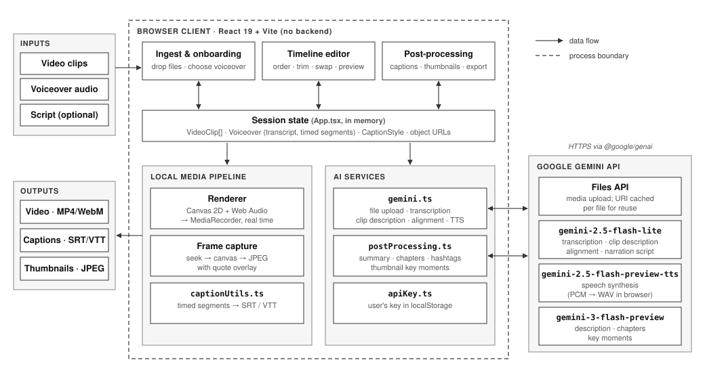

# Syncro

Syncro is a browser-based video editor that uses AI to turn a set of video clips and a voiceover into a rough cut. Gemini transcribes the narration, describes each clip, and suggests the clip order that best fits the voiceover. You then refine the cut on a timeline and export the video, captions, and thumbnails.

## How it works

1. **Ingest.** Upload video clips, then add a voiceover in one of three ways: upload an audio file, generate speech from a script (TTS), or let Gemini write and voice a narration based on the clips.
2. **Analyse.** The voiceover is transcribed and each clip is described in text. Media is uploaded once through the Gemini Files API and the file URI is cached for later calls.
3. **Align.** Gemini receives the transcript and the clip descriptions and returns a clip order as schema-constrained JSON. For each position it also returns 1–2 alternative clips, each with a confidence score and a reason.
4. **Edit.** On the timeline you can reorder, trim, swap in alternatives, set transitions, and preview the cut with captions synced to the voiceover waveform.
5. **Post-process.** Generate a summary, chapters, and hashtags. Pick thumbnail moments, which are captured from video frames and overlaid with a quote.
6. **Export.** The cut is rendered in the browser: frames are drawn to a canvas, mixed with the voiceover through Web Audio, and recorded with `MediaRecorder` (1280×720, 30 fps; MP4 where supported, otherwise WebM). Captions are written as SRT or VTT.

## Architecture

<p align="center">
  
</p>

<p align="center"><em>Figure 1. Syncro runs entirely in the browser. Its only external dependency is the Gemini API.</em></p>

- **Client only.** There is no server. All state is kept in memory in `App.tsx` and media is referenced through object URLs, so reloading the page clears the session.
- **AI calls** live in `src/services/`. Every call is recorded by `logger.ts` and shown in the in-app log panel.
- **Caption timing is estimated, not measured.** The transcript is split into sentences, and each sentence gets a share of the audio duration proportional to its length (`estimateSegments`). This saves a model call, but captions can drift on narration with uneven pacing.

### Models

| Task | Model |
|---|---|
| Transcription, clip description, alignment, narration script | `gemini-2.5-flash-lite` |
| Text-to-speech | `gemini-2.5-flash-preview-tts` |
| Description, chapters, thumbnail moments | `gemini-3-flash-preview` |

## Project structure

```
src/
  App.tsx                 session state, onboarding, alignment flow, preview
  components/
    Timeline.tsx          multi-track timeline, trimming, transitions, waveform (wavesurfer.js)
    ClipEditor.tsx        per-clip trim and text overlay
    VoiceoverEditor.tsx   voiceover trim
    PostProcessingPanel.tsx  description, captions, thumbnails, export
    LogPanel.tsx          Gemini call log
  services/
    gemini.ts             Files API, transcription, clip analysis, alignment, TTS
    postProcessing.ts     description/chapters, key-moment detection
    apiKey.ts             API key in localStorage
    logger.ts             call log store
  utils/
    captionUtils.ts       SRT / VTT generation
    exportUtils.ts        frame capture, thumbnail overlay, downloads
```

## Getting started

Requirements: Node.js 18 or later and a [Gemini API key](https://aistudio.google.com/apikey).

```bash
npm install
npm run dev        # http://localhost:3000
```

To set your key, click the key icon in the app header. The key is saved in this browser's `localStorage` and the browser sends it directly to Google.

```bash
npm run build      # production build to dist/
npm run lint       # type-check (tsc --noEmit)
```

## Notes

- Clips and audio sent for analysis are uploaded to the Gemini Files API.
- Export runs in real time, so a 2-minute voiceover takes about 2 minutes to render. Keep the tab in the foreground while it runs.
- Because the API key sits in the browser, this setup is meant for local or personal use. A shared deployment should route Gemini calls through a backend.
